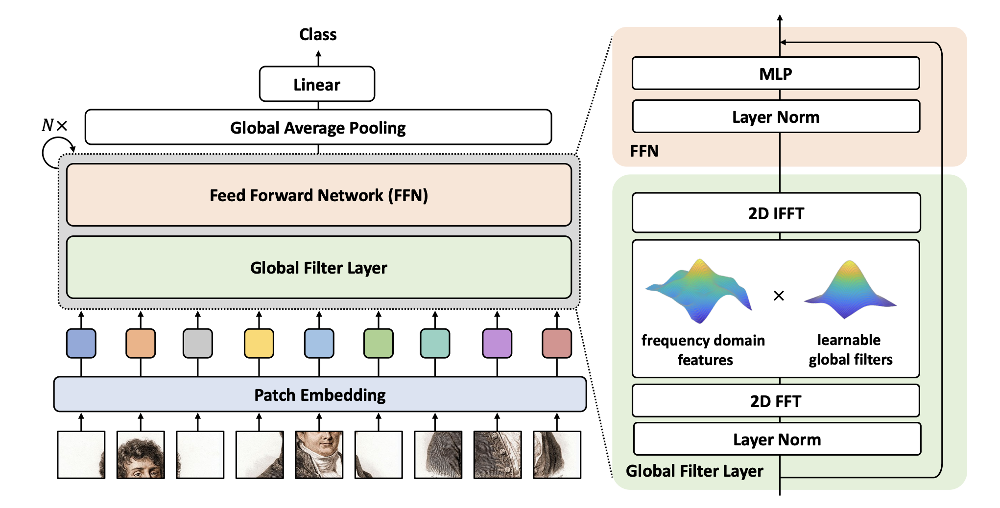
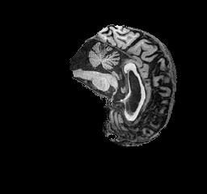
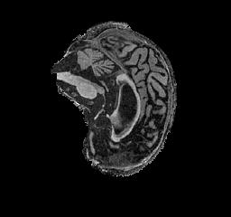
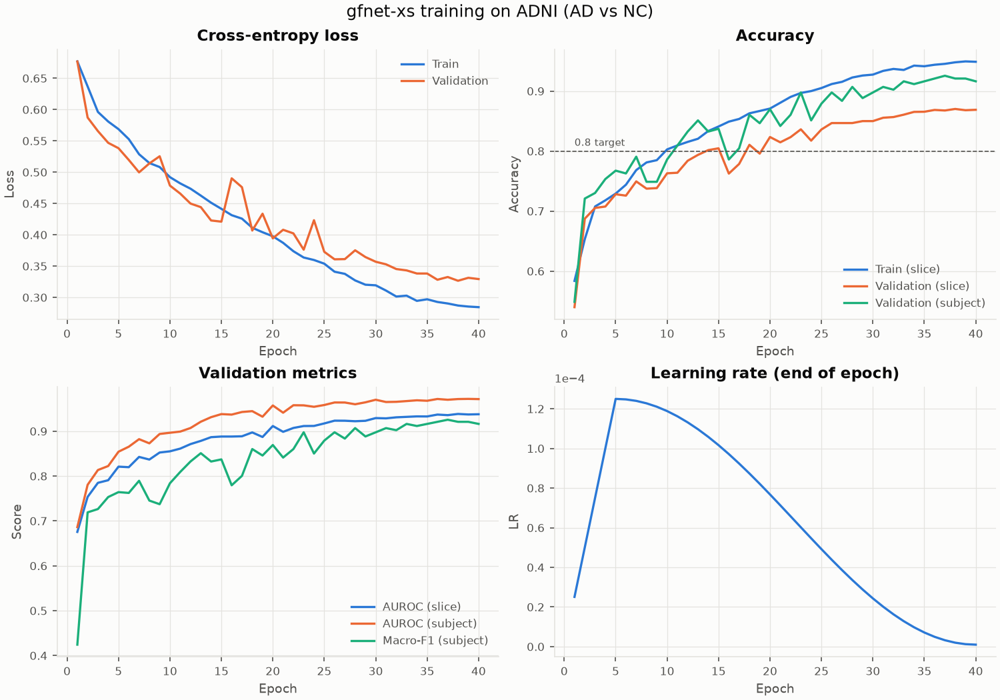
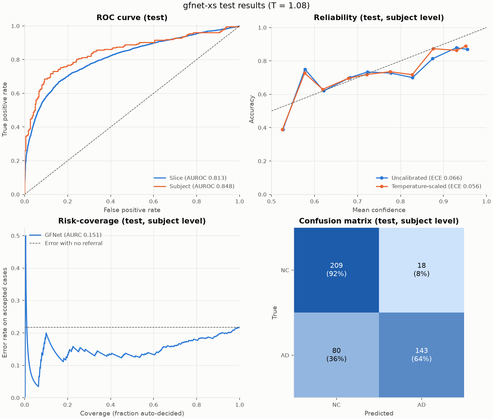
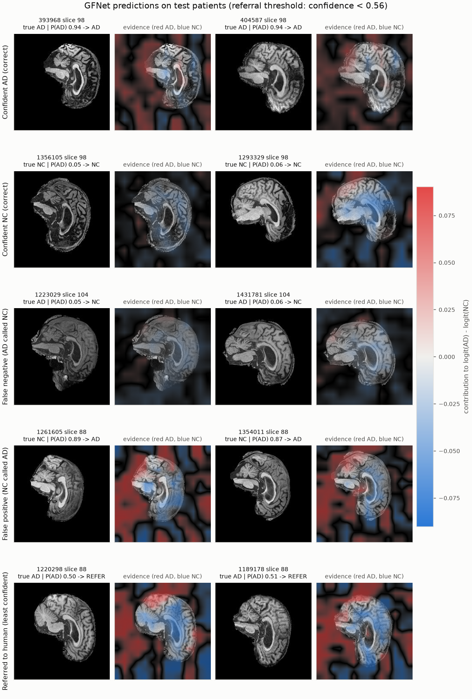
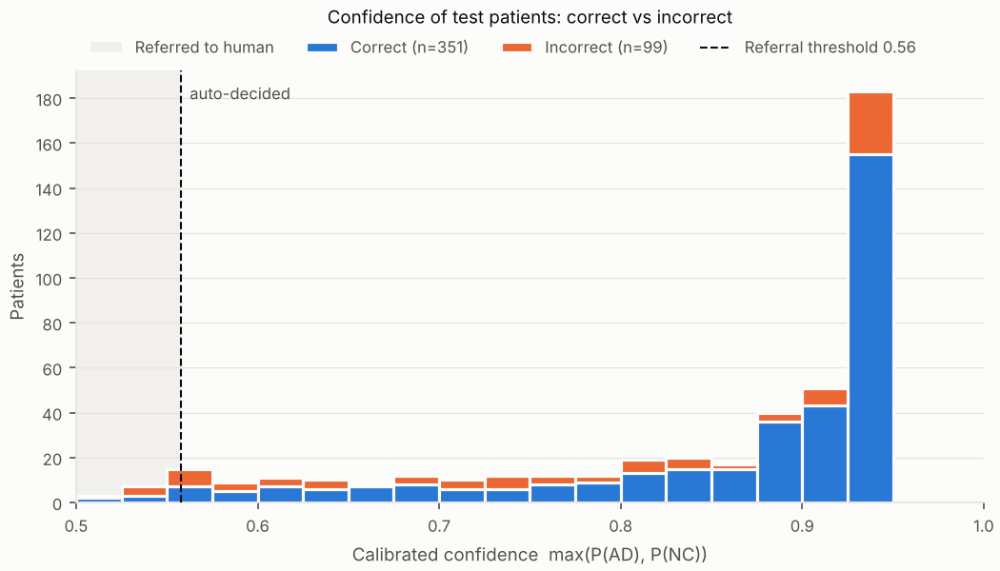
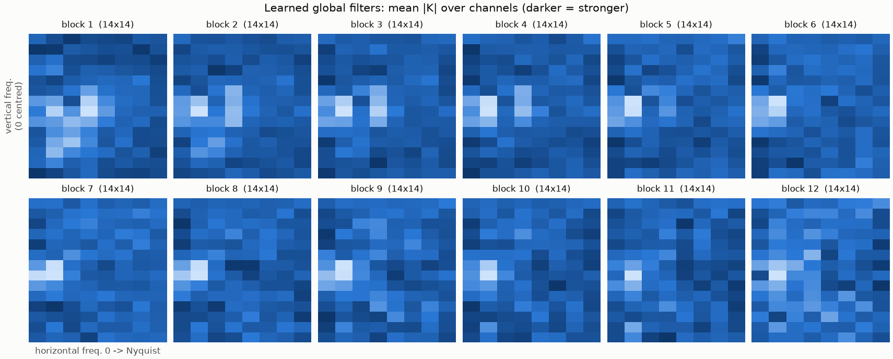

# GFNet for classification of Alzheimer's on the ADNI dataset

This repository implements the GFNet model by Rao et al. and assesses its effectiveness for classifying Alzheimer's disease based on brain MRI scans from the Alzheimer's Disease Neuroimagin Initiative (ADNI) dataset. It covers the full data preparation, training, validation, testing, and evaluation pipeline for the GFNet model. 

## About the GFNet model

Global Filter Networks (GFNet), introduced by Rao et al. (NeurIPS 2021), are a vision architecture that replaces the self-attention layer of vision transformers with a global filter layer. An input image is divided into non-overlapping 16 x 16 patches, each linearly projected into a token. In every GFNet block, the grid of tokens is transformed into the frequency domain with a 2D fast Fourier transform (FFT), multiplied element-wise by learnable global filters, and transformed back with an inverse FFT. This is equivalent to a depthwise convolution whose kernel spans the whole image, so every token interacts with every other. The cost, however, grows only log-linearly, $O(N \log N)$, rather than quadratically as in attention. A feed-forward network then mixes information across feature channels. On ImageNet, GFNet achieves accuracy competitive with transformer and MLP-style models of similar size, with favourable efficiency, generalisation and robustness.

---

## GFNet Architecture



- **Patch embedding:** the 224 x 224 slice is split into non-overlapping 16 x 16 patches, and each patch is linearly projected into a token of $D$ channels (384 for GFNet-XS). A learned positional embedding is added, giving a 14 x 14 grid of tokens.
- **Global filter layer (token mixing):** after LayerNorm, a 2D FFT converts each channel's 14 x 14 token map into the frequency domain. It is multiplied element-wise by a learnable complex global filter, and a 2D inverse FFT converts it back. Every token mixes with every other token at a cost of $O(N \log N)$.
- **Feed-forward network (channel mixing):** after a second LayerNorm, a two-layer MLP with GELU is applied to each token independently, mixing information across its channels. A residual connection adds the block's input to its output.
- **Stacking:** the global filter layer and FFN form one GFNet block, repeated $N$ times (12 for GFNet-XS).
- **Classification head:** the final tokens are normalised and averaged (global average pooling), and a linear layer outputs the AD and NC logits. A softmax converts these into class probabilities.

### GFNet Advantages

- **Efficient global context:** every patch sees the whole image at $O(N \log N)$ cost, cheaper than attention's $O(N^2)$.
- **Simple and interpretable:** one learnable filter per channel that can be plotted as a frequency response.

### GFNet Disadvantages

- **Static filters:** the same mixing is applied to every image, unlike attention, which adapts to each input.
- **Fixed input size:** filters are tied to the token grid, so other resolutions need interpolation.

---

## Quick Start

### Dependencies

| Package | Version used | Used for |
|---|---|---|
| Python | 3.11 | |
| PyTorch | 2.13.0 (CUDA 13.0 build, `+cu130`) | Model, training, inference |
| torchvision | TBC | Data transforms (`transforms.v2`) |
| Pillow | TBC | Loading JPEG slices |
| NumPy | TBC | Data loading and plotting only (not used by the model) |
| matplotlib | TBC | Plots |

```bash
conda create -n gfnet python=3.11
conda activate gfnet
pip install torch==2.13.0 torchvision==<TBC> --index-url https://download.pytorch.org/whl/cu130
pip install pillow==<TBC> numpy==<TBC> matplotlib==<TBC>
```

### Reproducibility

- **Fixed seed.** `--seed` (default 42) seeds Python and PyTorch, and also fixes the patient-level train/validation split, so the same command always uses the same patients in each split.
- **Fixed held-out test set.** The provided `test/` folder is never used for training, model selection, calibration or choosing the referral threshold; it is evaluated once at the end of each run.

```bash
python train.py --model gfnet-xs --drop-path 0.3 --epochs 40 --batch-size 64 --seed 42 --cache
python predict.py --checkpoint runs/run_NNN/best.pt
```

### Usage

++Run all commands from++ `recognition/gfnet-48825474/`++.++ `--root` ++points to the++ `AD_NC` ++folder (default:++ `/home/groups/comp3710/ADNI/AD_NC` ++on Rangpur).++

#### Train, validate and test: `train.py`

```bash
python train.py --root ../../AD_NC --model gfnet-xs --epochs 60 --batch-size 64 --cache
```

One run trains the model, validates every epoch, keeps the best checkpoint, fits a softmax temperature on the validation set, then evaluates once on the held-out test set.

| Option | Default | Purpose |
|---|---|---|
| `--model` | `gfnet-xs` | `gfnet-ti`, `gfnet-xs`, `gfnet-s`, `gfnet-b`, `gfnet-h-ti`, `gfnet-h-s`, `gfnet-h-b` |
| `--baseline` | off | Train the baseline CNN instead, on the same data and training setup |
| `--epochs` / `--batch-size` | `60` / `64` | Lower the batch size if GPU memory runs out (the LR scales with it) |
| `--lr` | `1e-3 x batch/512` | Peak learning rate (warmup then cosine decay) |
| `--pretrained` | none | Official GFNet ImageNet checkpoint to fine-tune from |
| `--cache` | off | Decode all slices into RAM once (~2 GB) for faster epochs |
| `--patience` | `15` | Early-stopping patience in epochs |
| `--out-dir` | `runs/gfnet` | Where outputs are written |
| `--limit-batches` | `0` | Debug: cap batches per epoch, e.g. `5` for a quick smoke test |

Outputs in `--out-dir`:

- `best.pt`, `last.pt`: checkpoints (weights, model config, normalisation stats, temperature)
- `training_curves.png`: loss, accuracy, AUROC/macro-F1 and LR, redrawn every epoch
- `history.csv`: per-epoch metrics
- `test_results.png`: ROC, reliability diagram, risk-coverage curve, confusion matrix
- `test_metrics.json`: final test metrics, calibration, selective-classification and compute cost
- `test_predictions.csv`: per-patient test probabilities and correctness

Baseline CNN for comparison (same splits, preprocessing, optimiser and evaluation):

```bash
python train.py --baseline --epochs 40 --cache
```

#### Predict: `predict.py`

```bash
python predict.py --checkpoint runs/gfnet/best.pt                        # held-out test set
python predict.py --checkpoint runs/gfnet/best.pt --target-acc 0.9       # looser referral rule
python predict.py --checkpoint runs/gfnet/best.pt --images path/to/slices/   # unlabelled slices
```

Loads the trained model, picks a referral threshold on the validation patients (the lowest confidence at which accuracy on auto-decided patients meets `--target-acc`, default 0.95), then classifies each test patient as AD, NC or REFER (routed to a human examiner). It prints accuracy, coverage, how many errors the referral catches and the least confident patients.

Outputs in `<checkpoint dir>/predict/`:

- `examples.png`: confident, misclassified and referred patients, each with an evidence heatmap (red = evidence for AD, blue = evidence for NC)
- `confidence.png`: confidence of correct vs incorrect patients with the referral threshold
- `global_filters.png`: learned global filter magnitudes per block
- `predictions.csv`: per-patient P(AD), confidence and decision

---

## Results

Example inputs, outputs, and visual plots of the GFNet model.

### Example inputs, outputs and plots

#### Input

- 20 greyscale sagittal slices per patient (240 x 256), cropped to 224 x 224 and normalised.

| AD (patient 393968, slice 98) | NC (patient 1356105, slice 98) |
|---|---|
|  |  |

#### Output of `train.py`

- Example run: `run_004` (GFNet-XS, drop-path 0.3, 40 epochs).
- Console summary of the test results:

```
TEST (subject level, n=450): acc 0.782  AUROC 0.848  macro-F1 0.777  sens 0.641  spec 0.921
TEST (slice level,   n=9000): acc 0.746  AUROC 0.813
ECE 0.066 -> 0.056 after temperature scaling;  AURC 0.151
  coverage 1.0: accuracy 0.782  (confidence >= 0.509)
  coverage 0.9: accuracy 0.805  (confidence >= 0.610)
  coverage 0.8: accuracy 0.822  (confidence >= 0.700)
  coverage 0.7: accuracy 0.838  (confidence >= 0.771)
  coverage 0.6: accuracy 0.867  (confidence >= 0.829)
  coverage 0.5: accuracy 0.871  (confidence >= 0.867)
```

- **Training curves:** tracks loss, accuracy, validation AUROC/macro-F1 and learning rate per epoch.



- **Test results:** ROC, calibration, risk-coverage for referral, and the confusion matrix.



#### Output of `predict.py`

- Example run: `run_002`.
- **`predictions.csv`:** per-patient P(AD), confidence and decision (AD, NC or REFER).

| patient_id | label | p_ad | confidence | predicted | decision | correct | slice_std |
|---|---|---|---|---|---|---|---|
| 393968 | AD | 0.9424 | 0.9424 | AD | AD | 1 | 0.0051 |
| 1356105 | NC | 0.0542 | 0.9458 | NC | NC | 1 | 0.0036 |
| 1223029 | AD | 0.0548 | 0.9452 | NC | NC | 0 | 0.0018 |
| 1261605 | NC | 0.8883 | 0.8883 | AD | AD | 0 | 0.1075 |
| 1220298 | AD | 0.5012 | 0.5012 | AD | REFER | 1 | 0.3371 |

- **Example patients:** correct, misclassified and referred cases with evidence heatmaps (red = AD, blue = NC).



- **Confidence distribution:** whether confidence separates correct from incorrect predictions.



- **Learned global filters:** filter strength per block across frequencies.



## Dataset Pre-processing

The ADNI (Alzheimer's Disease Neuroimaging Initiative) dataset used here is the course's pre-processed subset of T1-weighted brain MRI scans from Alzheimer's disease (AD) and cognitively normal (NC) participants, provided as 2D greyscale sagittal slices of 240 x 256 pixels, 20 slices per patient [1].

| AD (patient 393968, slice 98) | NC (patient 1356105, slice 98) |
|---|---|
|  |  |

### Patient-level train / validation / test split

| Split | AD patients (slices) | NC patients (slices) |
|---|---|---|
| Train (80% of `train/`) | 416 (8,320) | 445 (8,900) |
| Validation (20% of `train/`) | 104 (2,080) | 111 (2,220) |
| Test (provided `test/`) | 223 (4,460) | 227 (4,540) |

- **Split by patient:** all slices of a patient stay in one split, avoiding data leakage [2].
- **Stratified validation:** keeps the AD/NC ratio, fixed by `--seed`.
- **Validation use:** early stopping, model selection, calibration and the referral threshold.
- **Test use:** final evaluation only, run once.
- **Caveat:** IDs may identify scans rather than people, which could make validation optimistic.

### Intensity normalisation

- **Train-only statistics:** standardises intensities without leaking validation or test data.
- **Reused at inference:** stored in the checkpoint for consistent predictions.

### Cropping to 224 x 224

- **Removes background only:** random crop for training, centre crop for evaluation.
- **Matches GFNet:** 224 is the paper's input size [3], giving a 14 x 14 token grid.

### Data augmentation (training only)

- **Small rotations, shifts, scaling and intensity jitter:** mimic scan variation to reduce overfitting.
- **No horizontal flips:** atrophy can be asymmetric.
- **No Mixup/CutMix:** would distort the confidence used for referral [3].

**References**

1. Alzheimer's Disease Neuroimaging Initiative (ADNI). https://adni.loni.usc.edu
2. E. Yagis et al., "Effect of data leakage in brain MRI classification using 2D convolutional neural networks," *Scientific Reports*, vol. 11, 22544, 2021.
3. Y. Rao, W. Zhao, Z. Zhu, J. Lu, J. Zhou, "Global Filter Networks for Image Classification," *NeurIPS*, 2021. arXiv:2107.00645

## Core Investigation

Metrics and benchmarks to consider: 

- Model architecture's ability to reliably quantify uncertainty on ambiguous boundary cases
  - Run inference and examine a test case where the outcome is ambiguous, and then compare the classification probability after using softmax.
- Comparison of performance to a simple baseline
  - Comparison of the Top-1 accuracy and Top-5 accuracy percentages.
  - Compare performance to a generic CNN and MLP baseline
  - Consider the number of parameters and FLOPs required for the different models
- Correlation of model's predicted confidence score with diagnotic correctness
  - Comparison of the diagnostic label of the true data versus what the model predicted.
  - Check for false negative and false positive cases, and measure the degree of incorrectness.

## Engineering Reccomendation

## Establish empirical confidence threshold or reject option rule that automates ambiguous cases to human specialists.

- ## Whether the added complexity and computational cost justifies operational advantage over the baseline.