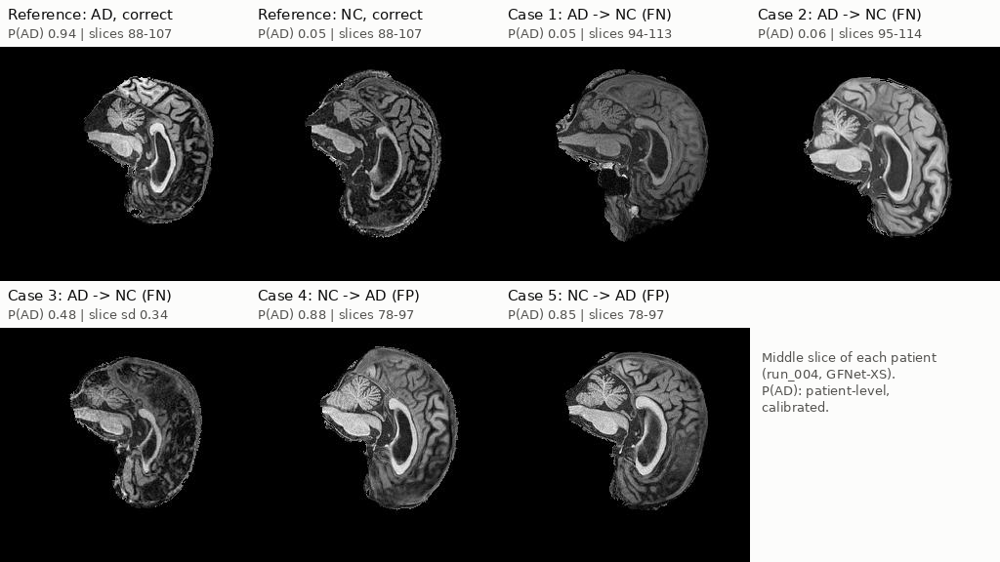

# GFNet for classification of Alzheimer's on the ADNI dataset

This repository implements the GFNet model by Rao et al. and assesses its effectiveness for classifying Alzheimer's disease based on brain MRI scans from the Alzheimer's Disease Neuroimagin Initiative (ADNI) dataset. It covers the full data preparation, training, validation, testing, and evaluation pipeline for the GFNet model. 

## About the GFNet model

Global Filter Networks (GFNet), introduced by Rao et al. (NeurIPS 2021), are a vision architecture that replaces the self-attention layer of vision transformers with a global filter layer. An input image is divided into non-overlapping 16 x 16 patches, each linearly projected into a token. In every GFNet block, the grid of tokens is transformed into the frequency domain with a 2D fast Fourier transform (FFT), multiplied element-wise by learnable global filters, and transformed back with an inverse FFT. This is equivalent to a depthwise convolution whose kernel spans the whole image, so every token interacts with every other. The cost, however, grows only log-linearly, $O(N \log N)$, rather than quadratically as in attention. A feed-forward network then mixes information across feature channels. On ImageNet, GFNet achieves accuracy competitive with transformer and MLP-style models of similar size, with favourable efficiency, generalisation and robustness.

---

## GFNet Architecture


- **Patch embedding:** the 224 x 224 slice is split into non-overlapping 16 x 16 patches, and each patch is linearly projected into a token of $D$ channels (384 for GFNet-XS). A learned positional embedding is added, giving a 14 x 14 grid of tokens.
- **Global filter layer (token mixing):** after LayerNorm, a 2D FFT converts each channel's 14 x 14 token map into the frequency domain. It is multiplied element-wise by a learnable complex global filter, and a 2D inverse FFT converts it back. Every token mixes with every other token at a cost of $O(N \log N)$.
- **Feed-forward network (channel mixing):** after a second LayerNorm, a two-layer MLP with GELU is applied to each token independently, mixing information across its channels. A residual connection adds the block's input to its output.
- **Stacking:** the global filter layer and FFN form one GFNet block, repeated $N$ times (12 for GFNet-XS).
- **Classification head:** the final tokens are normalised and averaged (global average pooling), and a linear layer outputs the AD and NC logits. A softmax converts these into class probabilities.

### GFNet Advantages

- **Efficient global context:** every patch sees the whole image at $O(N \log N)$ cost, cheaper than attention's $O(N^2)$.
- **Simple and interpretable:** one learnable filter per channel that can be plotted as a frequency response.

### GFNet Disadvantages

- **Static filters:** the same mixing is applied to every image, unlike attention, which adapts to each input.
- **Fixed input size:** filters are tied to the token grid, so other resolutions need interpolation.

---

## Feasibility review

Note: Some decision were changed from this feasibility review for the actual implementation of the code

- Chosen model: GFNet on the ADNI dataset, classifying Alzheimer's Disease (AD) vs Cognitively Normal (CN)

### User need, scope, and acceptance criteria

- **Need:** predict AD vs CN from brain MRI images; route low-confidence cases to a human for review
- **Prototype scope:** evaluate GFNet accuracy and computational trade-offs against other models for the same task
- **Acceptance criteria:**
  - reduced computational cost vs a similar-performing model, measured in $O(f(n))$ and FLOPs (e.g. ViTs)
  - ≥ 0.8 accuracy on AD vs CN
  - max VRAM under 16 GB

### Model choice and course concepts (HARD difficulty)

- **Dataset:** ADNI, train/test split 80:20, each with CN and AD sub-folders
- **GFNet architecture:**
  - split image into patches and embed them
  - global layer: normalisation + 2D FFT
  - element-wise multiplication of frequency-domain features with learnable global filters
  - inverse FFT back to spatial domain
  - standard feed-forward network
- **Paper evidence:** Rao et al. found GFNet feasible for classification on CIFAR
- **Course link:** Transformer Neural Networks (which GFNets build on) show suitability for image classification via global contextual relationships across features

### Preliminary feasibility evidence

- ADNI data is adequate
- Rao et al. show GFNet efficiency and accuracy on RGB images — reasonable evidence it works on images
- $O(L \log L)$ complexity: an EAIT lab RTX 2060 should suffice for smaller configs; otherwise use NVIDIA GPU sessions for more compute

### Risk, budget, and fallback

- **Technical risks:** patient data leakage between training samples, and leakage into the test set during the split
- **Compute budget:** 27 hours on NVIDIA data-centre GPUs and queue times on Rangpur
- **Fallback:** *(to be defined)*
- **Next planned experiment:** apply GFNet to other medical image classification contexts (e.g. artery size impact on AD vs CN)

---

## Quick Start

### Dependencies

| Package | Version used | Used for |
|---|---|---|
| Python | 3.11 | |
| PyTorch | 2.13.0 (CUDA 13.0 build, `+cu130`) | Model, training, inference |
| torchvision | TBC | Data transforms (`transforms.v2`) |
| Pillow | TBC | Loading JPEG slices |
| NumPy | TBC | Data loading and plotting only (not used by the model) |
| matplotlib | TBC | Plots |

```bash
conda create -n gfnet python=3.11
conda activate gfnet
pip install torch==2.13.0 torchvision==<TBC> --index-url https://download.pytorch.org/whl/cu130
pip install pillow==<TBC> numpy==<TBC> matplotlib==<TBC>
```

### Reproducibility

- **Fixed seed.** `--seed` (default 42) seeds Python and PyTorch, and also fixes the patient-level train/validation split, so the same command always uses the same patients in each split.
- **Fixed held-out test set.** The provided `test/` folder is never used for training, model selection, calibration or choosing the referral threshold; it is evaluated once at the end of each run.

```bash
python train.py --model gfnet-xs --drop-path 0.3 --epochs 40 --batch-size 64 --seed 42 --cache
python predict.py --checkpoint runs/run_NNN/best.pt
```

### Usage

++Run all commands from++ `recognition/gfnet-48825474/`++.++ `--root` ++points to the++ `AD_NC` ++folder (default:++ `/home/groups/comp3710/ADNI/AD_NC` ++on Rangpur).++

#### Train, validate and test: `train.py`

```bash
python train.py --root ../../AD_NC --model gfnet-xs --epochs 60 --batch-size 64 --cache
```

One run trains the model, validates every epoch, keeps the best checkpoint, fits a softmax temperature on the validation set, then evaluates once on the held-out test set.

| Option | Default | Purpose |
|---|---|---|
| `--model` | `gfnet-xs` | `gfnet-ti`, `gfnet-xs`, `gfnet-s`, `gfnet-b`, `gfnet-h-ti`, `gfnet-h-s`, `gfnet-h-b` |
| `--baseline` | off | Train the baseline CNN instead, on the same data and training setup |
| `--epochs` / `--batch-size` | `60` / `64` | Lower the batch size if GPU memory runs out (the LR scales with it) |
| `--lr` | `1e-3 x batch/512` | Peak learning rate (warmup then cosine decay) |
| `--pretrained` | none | Official GFNet ImageNet checkpoint to fine-tune from |
| `--cache` | off | Decode all slices into RAM once (~2 GB) for faster epochs |
| `--patience` | `15` | Early-stopping patience in epochs |
| `--out-dir` | `runs/gfnet` | Where outputs are written |
| `--limit-batches` | `0` | Debug: cap batches per epoch, e.g. `5` for a quick smoke test |

Outputs in `--out-dir`:

- `best.pt`, `last.pt`: checkpoints (weights, model config, normalisation stats, temperature)
- `training_curves.png`: loss, accuracy, AUROC/macro-F1 and LR, redrawn every epoch
- `history.csv`: per-epoch metrics
- `test_results.png`: ROC, reliability diagram, risk-coverage curve, confusion matrix
- `test_metrics.json`: final test metrics, calibration, selective-classification and compute cost
- `test_predictions.csv`: per-patient test probabilities and correctness

Baseline CNN for comparison (same splits, preprocessing, optimiser and evaluation):

```bash
python train.py --baseline --epochs 40 --cache
```

#### Predict: `predict.py`

```bash
python predict.py --checkpoint runs/gfnet/best.pt                        # held-out test set
python predict.py --checkpoint runs/gfnet/best.pt --target-acc 0.9       # looser referral rule
python predict.py --checkpoint runs/gfnet/best.pt --images path/to/slices/   # unlabelled slices
```

Loads the trained model, picks a referral threshold on the validation patients (the lowest confidence at which accuracy on auto-decided patients meets `--target-acc`, default 0.95), then classifies each test patient as AD, NC or REFER (routed to a human examiner). It prints accuracy, coverage, how many errors the referral catches and the least confident patients.

Outputs in `<checkpoint dir>/predict/`:

- `examples.png`: confident, misclassified and referred patients, each with an evidence heatmap (red = evidence for AD, blue = evidence for NC)
- `confidence.png`: confidence of correct vs incorrect patients with the referral threshold
- `global_filters.png`: learned global filter magnitudes per block
- `predictions.csv`: per-patient P(AD), confidence and decision

---

## Results

Example inputs, outputs, and visual plots of the GFNet model.

### Example inputs, outputs and plots

#### Input

- 20 greyscale sagittal slices per patient (240 x 256), cropped to 224 x 224 and normalised.

| AD (patient 393968, slice 98) | NC (patient 1356105, slice 98) |
|---|---|
|  |  |

#### Output of `train.py`

- Example run: `run_004` (GFNet-XS, drop-path 0.3, 40 epochs).
- Console summary of the test results:

```
TEST (subject level, n=450): acc 0.782  AUROC 0.848  macro-F1 0.777  sens 0.641  spec 0.921
TEST (slice level,   n=9000): acc 0.746  AUROC 0.813
ECE 0.066 -> 0.056 after temperature scaling;  AURC 0.151
  coverage 1.0: accuracy 0.782  (confidence >= 0.509)
  coverage 0.9: accuracy 0.805  (confidence >= 0.610)
  coverage 0.8: accuracy 0.822  (confidence >= 0.700)
  coverage 0.7: accuracy 0.838  (confidence >= 0.771)
  coverage 0.6: accuracy 0.867  (confidence >= 0.829)
  coverage 0.5: accuracy 0.871  (confidence >= 0.867)
```

- **Training curves:** tracks loss, accuracy, validation AUROC/macro-F1 and learning rate per epoch.


- **Test results:** ROC, calibration, risk-coverage for referral, and the confusion matrix.


#### Output of `predict.py`

- Example run: `run_002`.
- `predictions.csv`**:** per-patient P(AD), confidence and decision (AD, NC or REFER).

| patient_id | label | p_ad | confidence | predicted | decision | correct | slice_std |
|---|---|---|---|---|---|---|---|
| 393968 | AD | 0.9424 | 0.9424 | AD | AD | 1 | 0.0051 |
| 1356105 | NC | 0.0542 | 0.9458 | NC | NC | 1 | 0.0036 |
| 1223029 | AD | 0.0548 | 0.9452 | NC | NC | 0 | 0.0018 |
| 1261605 | NC | 0.8883 | 0.8883 | AD | AD | 0 | 0.1075 |
| 1220298 | AD | 0.5012 | 0.5012 | AD | REFER | 1 | 0.3371 |

- **Example patients:** correct, misclassified and referred cases with evidence heatmaps (red = AD, blue = NC).


- **Confidence distribution:** whether confidence separates correct from incorrect predictions.


- **Learned global filters:** filter strength per block across frequencies.


## Dataset Pre-processing

The ADNI (Alzheimer's Disease Neuroimaging Initiative) dataset used here is the course's pre-processed subset of T1-weighted brain MRI scans from Alzheimer's disease (AD) and cognitively normal (NC) participants, provided as 2D greyscale sagittal slices of 240 x 256 pixels, 20 slices per patient [1].

| AD (patient 393968, slice 98) | NC (patient 1356105, slice 98) |
|---|---|
|  |  |

### Patient-level train / validation / test split

| Split | AD patients (slices) | NC patients (slices) |
|---|---|---|
| Train (80% of `train/`) | 416 (8,320) | 445 (8,900) |
| Validation (20% of `train/`) | 104 (2,080) | 111 (2,220) |
| Test (provided `test/`) | 223 (4,460) | 227 (4,540) |

- **Split by patient:** all slices of a patient stay in one split, avoiding data leakage [2].
- **Stratified validation:** keeps the AD/NC ratio, fixed by `--seed`.
- **Validation use:** early stopping, model selection, calibration and the referral threshold.
- **Test use:** final evaluation only, run once.
- **Caveat:** IDs may identify scans rather than people, which could make validation optimistic.

### Intensity normalisation

- **Train-only statistics:** standardises intensities without leaking validation or test data.
- **Reused at inference:** stored in the checkpoint for consistent predictions.

### Cropping to 224 x 224

- **Removes background only:** random crop for training, centre crop for evaluation.
- **Matches GFNet:** 224 is the paper's input size [3], giving a 14 x 14 token grid.

### Data augmentation (training only)

- **Small rotations, shifts, scaling and intensity jitter:** mimic scan variation to reduce overfitting.
- **No horizontal flips:** atrophy can be asymmetric.
- **No Mixup/CutMix:** would distort the confidence used for referral [3].

**References**

1. Alzheimer's Disease Neuroimaging Initiative (ADNI). https://adni.loni.usc.edu
2. E. Yagis et al., "Effect of data leakage in brain MRI classification using 2D convolutional neural networks," *Scientific Reports*, vol. 11, 22544, 2021.
3. Y. Rao, W. Zhao, Z. Zhu, J. Lu, J. Zhou, "Global Filter Networks for Image Classification," *NeurIPS*, 2021. arXiv:2107.00645

---

## Investigation of the Open Research Dilemma

All results are on the same held-out test set (450 patients, 9,000 slices), with identical patient splits, preprocessing, optimiser and evaluation code. Values are taken from each run's `test_metrics.json` and `profile.md`.

### Runs compared

- `run_006` **CNN baseline:** 8-layer VGG-style CNN (`--baseline`), 40 epochs.
- `run_002` **GFNet-XS (first run):** drop-path 0.1, 60 epochs.
- `run_004` **GFNet-XS:** drop-path 0.3, 40 epochs. Best GFNet run.
- `run_005` **GFNet-H-Ti:** hierarchical GFNet with 4 x 4 patches, drop-path 0.3, 40 epochs.

### Quantitative benchmark (patient level)

| Model (run) | Accuracy | AD precision | AD recall | AD F1 | NC precision | NC recall | NC F1 | Macro-F1 | AUROC |
|---|---|---|---|---|---|---|---|---|---|
| CNN (`run_006`) | 0.753 | 0.938 | 0.538 | 0.684 | 0.680 | 0.965 | 0.798 | 0.741 | **0.877** |
| GFNet-XS (`run_002`) | 0.780 | 0.913 | 0.614 | 0.735 | 0.713 | 0.943 | **0.812** | 0.773 | 0.851 |
| GFNet-XS (`run_004`) | **0.782** | 0.888 | **0.641** | **0.745** | **0.723** | 0.921 | 0.810 | **0.777** | 0.848 |
| GFNet-H-Ti (`run_005`) | 0.749 | 0.882 | 0.570 | 0.692 | 0.686 | 0.925 | 0.788 | 0.740 | 0.829 |

| Model (run) | Slice accuracy | Slice macro-F1 | Slice AUROC |
|---|---|---|---|
| CNN (`run_006`) | 0.751 | 0.739 | 0.847 |
| GFNet-XS (`run_002`) | 0.756 | 0.750 | 0.816 |
| GFNet-XS (`run_004`) | 0.746 | 0.741 | 0.813 |
| GFNet-H-Ti (`run_005`) | 0.729 | 0.723 | 0.800 |

- **GFNet-XS vs CNN:** GFNet-XS has the best accuracy (+2.9 points), macro-F1 and AD recall, but the CNN has the best AUROC (0.877 vs 0.848).
- **First vs second GFNet-XS run:** more regularisation (`run_004`) reduced overfitting (train accuracy 0.985 to 0.949) and caught more AD, but overall accuracy barely moved.
- **GFNet-H-Ti:** finer 4 x 4 patches did not help; it is worse than GFNet-XS on every metric.
- **All models miss AD:** AD precision is high (0.88 to 0.94) but AD recall is low (0.54 to 0.64). Errors are mostly false negatives.
- **Benchmark:** no model reaches 0.8 test accuracy at full coverage (best 0.782 per patient).
- **Validation is misleading:** validation patient accuracy was 0.92 to 0.98 for every model, far above test. The cause is the data confound described in the autopsies below.

### Confidence vs correctness

| Model (run) | ECE (after temperature scaling) | AURC (lower is better) | Accuracy, 90% auto-decided | Accuracy, 80% auto-decided |
|---|---|---|---|---|
| CNN (`run_006`) | 0.182 | **0.130** | 0.780 | 0.817 |
| GFNet-XS (`run_002`) | 0.077 | 0.166 | 0.807 | **0.828** |
| GFNet-XS (`run_004`) | **0.056** | 0.151 | 0.805 | 0.822 |
| GFNet-H-Ti (`run_005`) | 0.091 | 0.165 | 0.778 | 0.794 |

- **Calibration:** GFNet-XS probabilities are the most trustworthy (lowest ECE). The CNN is badly calibrated, and temperature scaling made it worse because its validation set was over-optimistic.
- **Ranking errors:** the CNN's confidence ranks its errors best (lowest AURC), despite poor calibration.
- **Referral works:** referring the least confident 10-20% of patients lifts accuracy above 0.8 for both GFNet-XS runs.
- **Overconfidence remains:** some errors are made at more than 94% confidence, so confidence alone cannot catch every error.
- **Slice disagreement:** the spread of P(AD) across a patient's 20 slices is twice as high for wrong predictions (median 0.22) as for correct ones (0.10). It is a second ambiguity signal.

### Resource profiling

| Model (run) | Parameters | GFLOPs per slice | Peak VRAM, training | Peak VRAM, inference | Latency, 1 slice | Throughput | Time per patient (20 slices) | Training time |
|---|---|---|---|---|---|---|---|---|
| CNN (`run_006`) | **1.17 M** | 2.56 | **1.97 GB** | 0.82 GB | **1.3 ms** | **7,236 slices/s** | **2.8 ms** | **30.3 min** (40 ep) |
| GFNet-XS (`run_002`) | 15.40 M | 2.79 | 2.23 GB | **0.47 GB** | 6.3 ms | 5,475 slices/s | 3.7 ms | 47.4 min (60 ep) |
| GFNet-XS (`run_004`) | 15.40 M | 2.79 | 2.23 GB | **0.47 GB** | 6.2 ms | 5,388 slices/s | 3.7 ms | 32.4 min (40 ep) |
| GFNet-H-Ti (`run_005`) | 14.57 M | **2.03** | 3.58 GB | 0.64 GB | 10.6 ms | 3,066 slices/s | 6.5 ms | 35.0 min (40 ep) |

- All runs: NVIDIA A100 (40 GB), batch size 64, mixed precision (`run_002` did not record the device).
- **Similar compute:** the CNN and GFNet-XS cost about the same FLOPs, but GFNet-XS has 13 times more parameters and about 5 times the single-slice latency.
- **FFT is cheap:** the FFTs are about 1% of GFNet-XS's FLOPs.
- **H-Ti is costlier than its FLOPs suggest:** large early-stage feature maps make it the slowest and most memory-hungry model.
- **All are lightweight:** every model fits on a 4 GB GPU and classifies a patient in under 7 ms.

### Error autopsies (GFNet-XS, `run_004`)



- **Case 1, patient 1223029 (AD called NC, P(AD) 0.05):** low grey/white matter contrast and a blurred appearance compared with the references. Slices 94-113.
- **Case 2, patient 1330894 (AD called NC, P(AD) 0.06):** different intensity profile (bright grey matter), also from the 94+ slice range. Every model, CNN included, calls both cases NC with over 87% confidence.
- **Case 3, patient 1329357 (AD called NC, P(AD) 0.48):** noisy, low-quality slices; individual slices disagree strongly (spread 0.34). A genuinely ambiguous case.
- **Case 4, patient 1243833 (NC called AD, P(AD) 0.88):** prominent ventricles and sulci that resemble atrophy, plausibly normal ageing. Slices 78-97.
- **Case 5, patient 1274602 (NC called AD, P(AD) 0.85):** same pattern as case 4; all four models predict AD.

**Root trigger: slice range is confounded with the label in the training data**

| First slice index | Train AD | Train NC | Test AD | Test NC |
|---|---|---|---|---|
| < 80 | 353 | 210 | 102 | 62 |
| 80-89 | 167 | 111 | 67 | 51 |
| 90 or more | **0** | **235** | **54** | 114 |

- **No AD in training at 90+:** every training patient whose slices start at index 90 or above is NC, and these scans also look different (cases 1 and 2).
- **Shortcut learning:** the models learn "this kind of scan means NC" instead of atrophy. The test set contains 54 AD patients in this range, and the models miss 47 to 51 of them.
- **Not architecture-specific:** 76 test patients are misclassified by all four models (70 of them AD). Accuracy is 0.79 to 0.84 for patients below index 90 but only 0.68 to 0.71 at 90 and above.
- **Explains the validation gap:** validation is drawn from the training folder, so it shares the confound and cannot reveal it.
- **False positives (cases 4 and 5):** they come mostly from the < 80 range, which is AD-heavy in training, combined with age-related atrophy that genuinely resembles AD.

### Decision rule for routing to human experts

Referral rules applied to GFNet-XS (`run_004`) test predictions:

| Rule: refer the patient if... | Referred | Accuracy on auto-decided | Errors caught |
|---|---|---|---|
| Never (no referral) | 0% | 0.782 | 0 / 98 |
| Confidence < 0.70 | 20% | 0.822 | 34 / 98 |
| Confidence < 0.80 | 35% | 0.844 | 52 / 98 |
| 0.2 <= P(AD) < 0.7 | 30% | 0.845 | 49 / 98 |
| Slice spread > 0.25 | 25% | 0.831 | 41 / 98 |
| **0.2 <= P(AD) < 0.7, or slice spread > 0.25** | **32%** | **0.850** | **52 / 98** |

- **Recommended rule:** refer when 0.2 <= P(AD) < 0.7 or the slice spread exceeds 0.25. It refers about a third of patients and lifts auto-decided accuracy from 0.78 to 0.85.
- **Why asymmetric:** most errors are missed AD, so the band leans towards low P(AD) instead of being centred on 0.5.
- **Why slice spread:** it catches ambiguous cases such as case 3 that confidence alone misses.
- **Limitation:** about 40 confident false negatives (cases 1 and 2) remain, because the confound makes the model confidently wrong. No threshold can catch them.
- **Caveat:** these thresholds come from a test-set analysis. In deployment they must be set on held-out data that does not share the confound.

### Engineering recommendation

- **Do not deploy without referral.** No model meets the 0.8 target on its own; with the recommended rule GFNet-XS reaches 0.85 on the 68% of patients it decides automatically.
- **Fix the data before the model.** Rebuild the training split so every slice range contains both AD and NC, or flag scans from under-represented ranges for review. This targets the cause of most errors; architecture changes did not.
- **GFNet-XS over the CNN, narrowly.** GFNet-XS gives higher accuracy, sensitivity and macro-F1 and much better calibration, which matters for a referral threshold. The CNN gives better AUROC and error ranking at a thirteenth of the parameters and a fifth of the latency.
- **Trade-off verdict:** GFNet's added complexity is only weakly justified here. Its cost is modest (under 4 ms per patient, about 2.2 GB to train), but both models share the same dominant failure mode, so the deciding factor is data quality, not architecture.
- **Not recommended:** GFNet-H-Ti. It is slower, uses more memory and is less accurate than GFNet-XS.

---

## AI Disclosure

- Usage of AI models was primarily through Claude Opus 5.5 via the Cowork feature. 
  - The workflow to solve the problem with the assitance of AI was roughly as follows: discuss a concept from the original research paper and understand its application (e.g. embedding of patches into Fourier space) -> using AI to make changes to the codebase to implement this specific concept -> self-run the code and evaluate results (without AI)
  - Interpretation of model results was analyzed by a human before verifying each assumption with the AI
  - All test runs were manually done rather than AI automating the running of the code
- Verification responsibility
  - By using the above workflow all metrics and architectural decisions are 100% overlooked by the developer. The AI could make recommendations on which alternatives are possible, but the final decision was made by a human.
